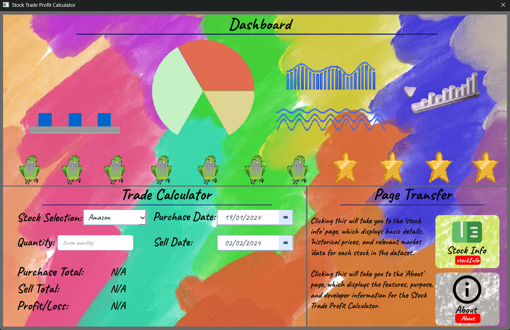

# Stock Trade Profit Calculator

This is a Python coursework project developed for the HCI & GUI Programming module at Griffith College Dublin.

The application allows users to calculate stock trading costs and profits or losses using historical stock price data.

## Features

- Select a stock from Amazon, Apple, Microsoft and Google.
- Enter the number of shares.
- Choose purchase and selling dates.
- Calculate the total purchase cost and selling value.
- Display the final profit or loss.
- View historical stock prices using line charts.
- Display the latest, highest, lowest and average stock prices.
- Show basic information about the stock dataset.

## Technologies Used

- Python
- PyQt6
- Matplotlib
- CSV
- CSS (Qt Style Sheets)

## Project Files

- `StockTradeCalculator.py` - Main Python program.
- `style.css` - Interface styling.
- `Stock_Market_Dataset.csv` - Historical stock price data.
- `Assets/` - Images, GIFs and fonts used in the application.

## How to Run

1. Install Python 3.
2. Install the required libraries:

   ```bash
   pip install PyQt6 matplotlib
   ```

3. Make sure all project files and the `Assets` folder are in the correct locations.
4. Run the program:

   ```bash
   python StockTradeCalculator.py
   ```

## Project Type

Individual Coursework

## Screenshots

### Main Dashboard


### Stock Information


### About Page


## Author

Yunlong Wang

Griffith College Dublin  
BSc Computing Science
